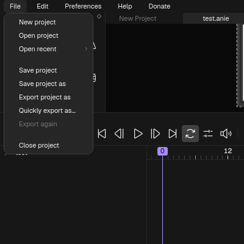
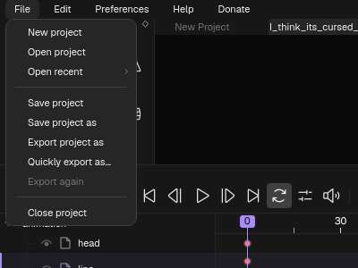
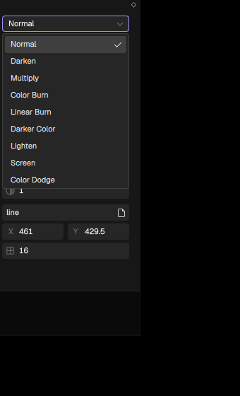
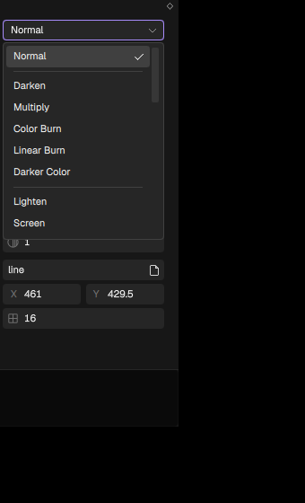
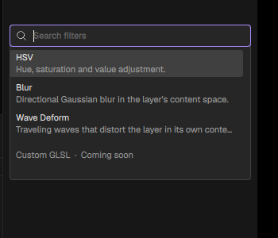
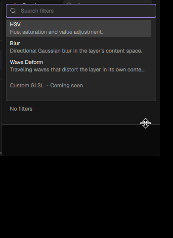
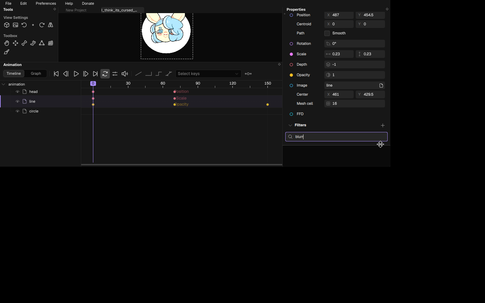
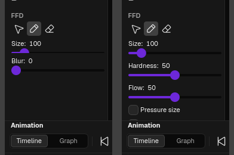

# Overnight round, 2026-10-26 — `notes.md`, low-entropy items

Twenty-three commits (listed in §6), each one concern, each with its own gate where a
gate was possible. Every number below was measured on this tree, and the suite is green at
62 targets. Images are in `docs/review/shots/`.

## 1. Fixed

| # | `notes.md` item | Cause (one line) | Gate |
|---|---|---|---|
| 1 | QMenu separator invisible | the rule painted `hairline`, the *same palette cell* as the menu body in dark: `#262626` on `#262626` = 1.00:1 | screenshot pair, §2 |
| 2 | Blend dropdown lost its separators and scrollbar | the QML port never carried the five `insertSeparator()` boundaries into the model, and attached no bar to a 28-row list capped at 220px | `inspector_view_model` |
| 3 | Filters don't apply until keyed | six renderer gates asked "does this lane have explicit keys at/after the first key" instead of "is the blended value above identity" | `wave_deform` [7] |
| 4 | FFD + Filter-mask controls draw over each other | `BrushPanel::updateGeometry` never accumulated `curPos.y()`: row items answer an *extent*, the panel answers an absolute bottom | geometry, below |
| 5 | Filter cards: only one expanded | one `mSelected` type on the stack model, re-applied on every refresh | `inspector_view_model` |
| 6 | Expanding a card moves the header | header `x/y/width` were a function of `expanded` (a 1px inset for the frame stroke) | `filter_card_geometry` |
| 7 | Filters "add" has no keyboard controls | Repeater with no selection; Return called `item.entry` (undefined) → `TypeError` | live, below |
| 8 | The filter catalog was unusable | the popup is clipped by the `QQuickWidget`'s own rectangle, and its height came out NaN so it collapsed to its search field while the rows were laid out at correct rectangles | live, below |
| 9 | Ctrl+Z ceased to work | the Properties `QQuickWidget` keeps `StrongFocus` and `QQuickWidget::keyPressEvent` never calls the base, so the key walk dies there; the viewport could not take focus back | `probe_undo_key.sh` |
| 10 | Info box prints "Undone : X" | an assembled string with a verb, a separator and an often-empty command name; `UILogType` was discarded | `command_log` |
| 11 | Card tooltips invisible | `z` orders siblings only; the card body and every later card painted over the bubble | `tooltip_contract`, `form_layout`, `picker_keyboard` |
| 12 | (not in notes) crash on every quit | `TimeLineHeader`'s dtor disconnected a signaller whose owner the child sweep had already freed | `probe_quit_clean.sh` |
| 13 | (not in notes) cubic Hermite at thirds | every Custom evaluation solved x→t although x(t)=t when both handles sit on the thirds | `easing_regression` |
| 14 | (not in notes) PSD layers the app cannot reproduce | a fill layer aborted the whole import; an adjustment layer imported as a silent 1×1 | `psd_layer_identity` |
| 15 | A typo in the filter search emptied the list | every rule needs the token to be INSIDE a word, so `blurr` (one letter too many) matched nothing | `fuzzy_match`, `inspector_view_model` + live |
| 16 | Nine QML scroll bars, four different looks | each surface restated its own lane/pill ink, and the two that copied the widget numbers let the handle collapse to 1px | measured below |

Plus two harness defects without which none of the QML work could be driven or
photographed: every Quick item in the dock reports `showing=False` (`AE_UI_ANY=1`
opts out), and the panel's rows report stale rectangles until a layer is selected.

## 2. Measured, before → after

**Menu separators** — dark theme, File menu. Before: the group gaps hold nothing.
After: a 1px `#404040` rule in each gap (1.46:1 on the menu body; light theme is
byte-identical to before).

| before | after |
|---|---|
|  |  |

**Blend dropdown** — before: 28 rows, no group rules, no bar, the list ends mid-row at
the popup edge. After: five group rules and the app's 4px pill in a 12px lane.

| before | after |
|---|---|
|  |  |

**Filter catalog** — the placement is DECIDED from the host, not assumed. The Filters
section is the panel's LAST one, so how much room it has below depends on the window and
on the panel's scroll:

| state | measured |
|---|---|
| short board (`test.anie`, panel not scrolled) | field at `y=71`, rows `103…217` → opens **down** |
| big project, section at the panel's bottom | `roomBelow=35`, `roomAbove=313` → opens **up** |

| opens down | opens up |
|---|---|
|  |  |

And the typo case the report was about — `blurr` keeps exactly the row it meant
(`inspector_view_model`: `blur=1432`, `blurr=100`, `hsb=-1`, `zzzz=-1`):



**FFD tool panel** — the same panel, same layer, same window (Tools dock grown to 342px
by dragging its bottom edge), before and after:



Left: `Size` and `Blur` are the only rows that fit, because Hardness, Flow and both
pressure boxes are drawn ON TOP of them. Right: six rows in order. The rectangles on one
selected layer:

| control | before | after |
|---|---|---|
| Size | y=225 | y=225 |
| Hardness | y=262 | y=262 |
| Flow | **y=262** | y=299 |
| Pressure size | **y=262** | y=336 |
| Pressure flow | y=249 | y=360 |
| Blur | **y=254** | y=389 |
| panel rect | 169 + **125** | 169 + **260** |

Three controls on one row became six rows in order, and the card reports its real
height.

**Quit** — `probe_quit_clean.sh`, 5/5:

```
PASS closing the window through the WM with X alive exits 0 (measured 0; pre-fix 139, one core per run)
PASS killing the X server under the running application does not crash (measured exit 1, 0 or 1 is a clean finish; pre-fix 139)
PASS no new dumped-core line for the application in the run window (measured 0; pre-fix one per run)
```

**Ctrl+Z** — `probe_undo_key.sh`, 13/13, of which the load-bearing ones:

```
PASS the inspector edit changed the document value ([1] -> [0])
PASS ctrl+z with the Properties panel focused put it back
PASS ctrl+shift+z redid it from the same focused state
PASS with the number field editing, ctrl+z stays the field's own
PASS the inspector edit reaches the canvas (5277 pixels changed)
PASS and the undone frame is the pre-edit one (only 0 of the 5277 edited pixels still differ)
```

**Command log** — `command_log`:

```
PASS test 3: the selection copies as plain text across entries
PASS test 4: an empty command name renders the badge alone
PASS test 6: after the switch the badge ink is the NEW textMuted (#737373, was #a3a3a3)
PASS warn-vs-info: the warning row carries a tinted "Warning" badge in #fbbf24
```

**Filter cards** — `inspector_view_model`:

```
expanded with both cards open: hsv:open blur:open
expanded after refreshFrame:    hsv:open blur:open
expanded after moving blur:     blur:open hsv:open
expanded after undoing:         hsv:open blur:open
```

Live: pressing the new disclosure marker on two cards leaves both reporting
`Collapse <filter>`, i.e. two cards open at once.

**Cubic Hermite** — `easing_regression`:

```
thirds fast path: |stored-solve| max 4.225e-08 … |fast-cubic| max 3.496e-08
crossed default: max |crossed - smoothstep| = 0.117301 at x=0.355
arbitrary pair (0.2, 0.1, 0.8, 0.45): |eval-solve| max 1.447e-07
```

**Static filters** — `wave_deform` [7], a `Blur` added and edited but never keyed:

```
[7] default-key edits at frame 0: blur keys=0 radius=8,000, hsv keys=0 hue=40
[7] edited back to the identity: radius=0,000 hue=0 sat=100 val=100
[7] keyed at frame 10, read at frame 0: radius=5,000 hue=90
[7] the blended value (not the key map) decides which filters are live
```

`keys=0` with `radius=8` is the fix: the predicate now reads the value the blender
produced from the lane's DEFAULT key. **Caveat, and it is a real one** — see §3.

**PSD compatibility corpus** — `scripts/psd/audit.py` over
`~/Downloads/kemono_psd_1` (104 files, all RGB 8-bit, 9686 layers):

| verdict | files |
|---|---|
| clean | 72 |
| approx (masks / flattened text / smart objects) | 19 |
| lossy (fill or adjustment layers import EMPTY) | 13 |

Corpus totals: 23 fill layers, 46 adjustment layers, 2 smart objects, **260 masks —
141 on LAYERS (26 files) and 119 on GROUPS (14 files)**, 2891 clipping layers, 1437
groups. The split matters: a layer mask multiplies one node's alpha, a group mask
multiplies a composited subtree's, and they are two different features. The worst two files are `000144.psd`
(9 fill + 18 adjustment) and `000145.psd` (12 fill + 13 adjustment) — exactly the files
whose import now warns instead of failing. And the single most widespread cause of "my
file looks different" is not a layer kind at all: the 260 masks, which are parsed and
never composited.

## 3. One loose end, stated as a question rather than a defect

**Writing a filter's value through the inspector does not change the canvas in the
session — yet the value clearly reaches the document.** The measurements contradict each
other, so this is written down as an open question with the evidence, not as a bug I
claim to have proved:

1. on a COPY of a real project: select a layer, add `Blur`, write "Blur amount" = 200 →
   `Ctrl+S` → relaunch. The relaunched canvas differs from the pre-filter state by
   **25385 px** (8.4% of the canvas crop, `shots/static-blur-pair.png`). So the value IS
   written to the lane's DEFAULT key and the fixed renderer predicate DOES apply it.
2. in the same session, before the reload, the canvas does not change: not immediately,
   not after a `ctrl+Right`/`Left` frame step, not after toggling the filter's eye.
3. one run's `Edit → Undo` right after the write put the field back to 0, which is only
   possible if a command was pushed — while an instrumented `KeyAccessor::assignBlur`
   never printed in another run of the same sequence, and an instrumented render never
   saw the blended radius leave 0.

Point 1 settles the product question; points 2 and 3 disagree about whether the write
reaches the model in-session at all. The likeliest explanation is the PROBE, not the app:
`ae_ui.py set` takes the first node with a Value interface, and a Qt Quick field has TWO
(the app's own `aeAccessibleValue` marker and Qt's default node for the widget). Qt's node
writes the QML property and emits nothing, so the field shows the new number while the
document keeps the old one — a silent no-op that looks exactly like a renderer bug.
The next step is therefore a harness one: make `set` prove it wrote the app's own marker
(or prefer it explicitly), then re-run the pair above. Until then nothing in this report
should be read as "the filter value does not commit".

What is NOT in doubt: `wave_deform` [7] drives the production blender and shows a blur of
radius 8 at frame 0 with zero keys on the lane, and the reload above shows the same value
rendered on the canvas.

## 4. Judged, no change needed

**Fuzzy search — done properly, and the first answer here was wrong.** I argued "four
entries is not a search problem"; that misses the actual defect: a TYPO returned an EMPTY
LIST, which is broken at any catalog size, and the matcher already existed, so doing it
now costs less than retrofitting it later.

Wiring the existing matcher in was NOT enough, and that is the part worth recording:
`FuzzyMatch` had no insertion tolerance, so `blurr` (one letter too many) still matched
nothing — every rule needs the token to be a SUBSEQUENCE of a word, and a longer token
cannot be one. So the matcher gained one rule (bounded Damerau-Levenshtein: adjacent
transposition counts as one edit, one edit below seven characters and two above, scored
BELOW every real rule so a correction never outranks a true match), the catalog now reads
`FilterStackModel::catalogScore` = `fuzzy::queryScore(name ‖ 0x1F ‖ description)`, and the
picker's visibility, its highlight walk and its Return all read that one score.

Measured (`inspector_view_model`, against the four catalog rows): `blur → 1432`,
`blurr → 100`, `bulr → 100`, `blu → 1123`, `blurr` against the HSV row `→ -1`,
`zzzz → -1`, `hsb → -1` (three letters are below the tolerance floor), empty query `→ 0`
(every row). Live: `ae set "Search filters" blurr` leaves exactly `showing Blur`, with HSV
and Wave Deform hidden.

On the library question, now answered on merit rather than on the fact that a test exists:
the matcher scores by rule bands (whole word 1000+8L, prefix 700+8L, initials 600+8L,
substring 400+8L−offset, joined run 350+8L−offset, subsequence 200+8L−gap, correction
120+8L−60·d) with a field-local phrase bonus. That is the fzf family's shape without its
fuzzy core; fzf's algorithm or a rapidfuzz port would add edit-distance RANKING everywhere
and a dependency, and neither models the field-local phrase rule this picker relies on.
Recommendation: keep it, and treat rule 7 as the general answer to "a typo must not empty
the list" instead of special-casing the catalog.

**Photoshop's brush HUD is not a dominant-axis lock.** Photoshop's Alt+RMB HUD is a 2D
pad (horizontal = size, vertical = hardness, with a "vary hardness on vertical movement"
preference) and has no snap. The lock shipped in commit "tools: latch the brush drag to
one axis" is an AnimeEffects decision to fix the reported annoyance, and the code says
so rather than claiming parity.

**Folder opacity / pass-through** — the claim was verified against the code and against
`psd-tools` 1.26.0 (installed here; Krita and GIMP are not). Part 1 is mis-diagnosed:
folders *do* have a blend mode; what is missing is a pass-through flag distinct from
`Normal`, and the real PSD signal (`lsct` = `pass`) is parsed and never read. Part 2 is
true for the default path — the folder's opacity is multiplied into each descendant's
`worldOpacity`, so two overlapping opaque children at a 50% group reach `0.75` alpha
instead of `0.5` (`psd-tools`: 128 vs 191 on a synthetic fixture). `FolderNode`'s
composite path already does it right; it is simply never entered for a `Normal` folder.
The fix needs a premultiplied lerp pass, a format bump, an import change and a UI
control that can express both states — a product decision, so it is not in this round.
Design and risks are in `AGENTS.md`.

**Pose keys in the graph / Auto easing on FFD and Pose** — answered: Bone and Mesh
carry no easing (structural, step-held) so disabling the quick easings for them is
truthful; Pose and FFD carry ONE shared param for the whole key and Auto derives it from
the single bone/vertex that moves most, which is the real limitation; pose easing *does*
affect playback (a linear per-bone lerp scaled by one eased scalar); and the graph
cannot show pose keys because `componentCount(Pose) == 0`. Judgement: give the pose
per-bone channels *inside one pose key* — keep the key as the document/undo unit, split
the easing.

## 5. How to re-check

```bash
cmake --build build --config Debug -j"$(nproc)"
scripts/run_suites.sh Debug                       # 62 targets
QT_QPA_PLATFORM=offscreen build/tests/Debug/command_log
scripts/gui/probe_undo_key.sh                     # Ctrl+Z from the inspector
scripts/gui/probe_quit_clean.sh                   # clean exit, no core
scripts/psd/audit.py ~/Downloads/kemono_psd_1     # the corpus table above
```

## 6. The commits (25)

```
96021425 theme: draw a rule on a floater in the floater's own edge token
4885b0d3 core: a filter is live from its blended value, not from its keys
878a94b3 util: skip the x-to-t solve when both handles sit on the thirds
da983d1e properties: independent filter cards, a steady header, and the blend list's groups
dcce2c33 properties: give the filter catalog the keyboard controls it was missing
28dc3f13 gui: the command log is a record, and its undo/redo lines are badges
5145903f gui: Ctrl+Z reaches the command map again from the inspector
614994dd gui: mount the hover label in the window overlay so a card cannot cover it
5752a495 tools: give the brush block its real height back
99820586 tools: latch the brush drag to one axis, and let the ring follow the pointer
bc04a400 img: a PSD layer we cannot reproduce warns instead of failing the import
d1ee6018 scripts: let a probe address the QML inspector's controls
b55e9dd6 tests: say which assertion catches a tooltip clamp that widened
f825f663 gui: stop crashing on every quit
b5462224 properties: open the filter catalog upward, where the room is
af728430 scripts: audit a PSD corpus for the features the importer degrades
618de91b properties: let a filter card be expanded without a mouse
373f5682 docs: record the low-entropy round, with the evidence and the open questions
697bfe4d tests: a filter card's header must not move when the card expands
2c971d5a docs: add the commit list and the geometry gate to the review pack
ff86dcce tests: make the card-geometry gate show that its fixture can fail
b016ca7d tests: give the new gate the project's version defines
1de4206f docs: attribute the probe sweep, with a pre-round build for the two that mattered
8cb75100 docs: refresh the review pack's commit list
1376b939 docs: fix the review pack's own count
```

Every one is a single concern with its reason in the code it touches; the suite is green
(`scripts/run_suites.sh Debug`) and each behavioural change has the gate named in §1.

## 7. The live probe sweep, and what is NOT mine

`scripts/gui/run_probes.sh`: **20 pass / 8 fail / 0 stale**. The eight are
`probe_exportbg`, `probe_graph_ink`, `probe_graph_keys`, `probe_projectsettings`,
`probe_scrub`, `probe_settings`, `probe_timeline_ink`, `probe_timeline_marquee`.

Two of them were re-run against the PRE-ROUND commit (`ef5386e3`, built in a throwaway
worktree) to attribute the red, and they fail IDENTICALLY there:

| probe | pre-round commit | this round |
|---|---|---|
| `probe_settings` | 3 FAILED (the same three: a pointer click on a combo field does not open its list) | 3 FAILED, same assertions |
| `probe_scrub` | 1 FAILED (`got v0=0 v1=0`) | 1 FAILED, same numbers |

So those two are baseline redness on this machine, not regressions from tonight — and the
same check (a worktree at the previous commit, ~4 minutes to build the app) is the way to
attribute the other six, which were not re-run. Note that `probe_settings`' failing
assertions are labelled "a pointer click …" while the steps actually use the
accessibility press, and that a hand-driven reproduction of the same steps with tonight's
binary DOES open the list ("showing Japanese") — so the probe itself is the more likely
subject there than the combo.

`probe_quit_clean.sh`, `probe_undo_key.sh` and `probe_timeline_ink.sh`'s ruler phase are
the only probes this round added or knowingly touched; the first two are green (§2).

## 8. The cubic Hermite path: measured, and exactly when it applies

Measured through the SHIPPING functions (400,000 evaluations each; same y values, only
the control x differs). **These are RELEASE numbers** — every timing I published before this
was a Debug build, which inflates them 3–4× and is not what a user runs:

| curve | Release, per evaluation |
|---|---|
| stored thirds pair — fast path | **17.8 ns** |
| stored `0.2 / 0.8` — solves x→t | **81.1 ns** |
| derived pair (Auto out / AutoClamped in) — one-shot | **78.9 ns** |
| the same pair from a PREPARED segment | **5.7 ns** |
| `controlPoint` ×2 alone (the derivation) | **53.5 ns** |
| a graph polyline, 8 curves × 600 samples | **27 µs** prepared, 379 µs one-shot |

So the fast path is **4.6×, ≈63 ns per evaluation**, and `max |fast − solver| = 4.3e-8` over
1001 samples. The interesting row is the fourth: a derived segment's own cost is the
DERIVATION, not the solve — which is what `util::EasingSegment` exists for, and why the
graph polyline (the one place a segment is sampled 600 times per repaint) is the caller that
matters.

`Easing::calculate` is now a one-shot wrapper over `util::EasingSegment`, so there is ONE
statement of the thirds rule and one solver, and the caller that samples repeatedly —
`ctrl::graph::Curve` — prepares each segment ONCE (`Curve::prepareOver`) instead of
rebuilding the channel values, both params, the neighbour walk, the AutoContext and the two
control points on every point of the polyline. That is the 379 µs → 27 µs row above,
projected from the primitive; the in-app number is not measured here. `tests/easing_regression` keeps the independent evidence (the
sweep against `UnitBezier` and the bitwise branch assertions, 999/999 each) and adds a
consistency guard that the prepared segment equals the one-shot surface bit for bit — a
guard, explicitly not an oracle, since both sides are now the same code.

One trap the refactor paid for: `EasingSegment` holds the `UnitBezier` in a `std::optional`
rather than as a member. A member has to be constructed in every segment, and constructing
one builds its 11-entry spline table — so the first version was SLOWER than the code it
replaced on the exactly-fast path (250 ns against 37.5 in Debug). With the optional, the
fast path builds no spline at all.

**When it applies, precisely.** Only a `Type_Custom` param reaches the bezier at all (the
other types use the closed-form table). Within Custom, the fast path needs BOTH stored
sides' x to be exactly `1/3` and `2/3`:

| where the two facing handles come from | fast path? |
|---|---|
| `Vector`, `Auto`, `AutoClamped` on both sides | **yes** — `controlPoint` returns `1.0/3.0` and `2.0/3.0` verbatim |
| a derived side later FROZEN back to Free/Aligned | **yes** — the freeze stores the floats it was drawing |
| either facing side actually dragged (Free/Aligned) | no — arbitrary x, the solve stays |
| the `Param` default pair `(2/3, 1/3)` (crossed smoothstep) | no |

**Is there an epsilon?** No — but my first answer to this was wrong-shaped, so here is
the accurate version. A *tiny* epsilon would be harmless: y is continuous in x, so a pair
within 1e-8 of the thirds moves the curve by ~1e-8·slope, which is nothing. The reason is
not visual at all: **`y(x) = B_y(x)` is only the true curve when `x(t) = t`**, and that
identity holds at the thirds and nowhere else. An epsilon admits pairs where it fails by up
to ε·(dy/dx). How wrong that is depends entirely on ε: at 1e-8 it is a rounding error and
nothing else, at 1e-3 it is a visible sub-pixel offset, and either way it is a difference the
solver never had. Measured on a pair 1e-6 off the thirds: `cubic 0.345757604` against
`solve 0.345757395`. The case for exactness is therefore not "wrong vs right" but **it
costs nothing and adds nothing**: every intended producer already writes those exact floats
(so an epsilon buys no extra hits), and exactness makes the change provably bit-identical for
them and provably untouched for everything else. An epsilon is a defensible alternative - if
one is ever wanted, bound it by the solver's own `kBezierEpsilon` (1e-7) so the fast path can
never disagree with it by more than its own tolerance.

**The predicate is arithmetic, not mode-based.** The fast path fires iff
`type == Custom && x_out(from key) == float(1/3) && x_in(to key) == float(2/3) && 0 ≤ x ≤ 1`.
A mode only decides which x gets WRITTEN: `Vector`/`Auto`/`AutoClamped` write the thirds
verbatim, so they always qualify and never run the full solve; a derived handle frozen back
to Free keeps those floats and qualifies too; a dragged side stores an arbitrary x and does
not; the crossed default `(2/3, 1/3)` does not.

So "every segment with auto easing" is the wrong frame — the right one is **every segment
whose two facing x are exactly the thirds**, which is what the Auto preset writes at BOTH
ends. One auto side facing a dragged side does not qualify.

**Which branch ran is gated now, not inferred.** A value tolerance cannot prove it (the two
branches agree to their own rounding), but their floats are not always identical, so
`easing_regression` sweeps 999 samples and asserts bitwise equality against the branch that
must have run: the thirds pair equals the direct cubic in **999/999**, a pair 1e-6 off the
thirds equals the SOLVER in **999/999** (952 of those samples could have told the
difference, and 261 of the thirds samples do). A build where the fast path never fires fails
that gate.

### What a mask should be: a CHANNEL, not a node — and how it animates

My first sketch here was hand-waving: it said "not a tree node" and then failed to say how
the thing gets a lane or how it animates. Corrected, on this engine's own terms.

**It animates because it is a `TimeKeyType`, like every other channel.** A mask's payload is
an alpha field; two mask keys blend by LERPING THE FIELDS with the key's easing, which is
`TimeKeyBlender::blendFFDKey`'s shape exactly (`dst[i] = v0[i]*(1-t) + v1[i]*t`, `t` from
`getEasingRateFromTwoKeys`) with a texel instead of a vertex. So nothing is painted per
frame: you key mask SHAPES at a few frames, exactly as you key FFD vertices, and playback
interpolates. (The one precedent NOT to copy is `ImageKey`, which is STEP-HELD -
`getImageKey` uses `findLastKey` - so an image switches rather than fades; a mask that
switched would read as a pop.)

**It gets a lane for free, because lanes are channels.** `TimeLine::validTypeCount()` counts
the types whose key map is non-empty, `TimeLineRow::calculateHeight` is
`kIncrease * validTypeCount()`, and keys are placed by their index among the valid types -
so the first mask key gives the layer a `Mask` lane under its existing lanes with no
timeline work at all. `Opacity` is the same kind of thing: a channel that appears as a lane
and never as a tree row.

**Where it appears.** Three places, none of them a tree node: the timeline lane above; a
per-row affordance in the object tree next to the image field / `Clipped` checkbox, which
selects the mask channel and reveals the Mask tool; and an inspector row carrying the same
three-state key dot the other channels have (static / animated / keyed). The Mask tool then
paints the field of the CURRENT key - the brush we already have, pointed at this field
instead of a filter's.

**Why not a tree node — without the depth-sort argument** (you are right that the depth
counter should not be a design constraint; it is legacy and worth redesigning separately):
1. A mask has no independent render. As a node it needs a back-link to its owner, which is
   the clipping problem again, plus a prohibition on reordering, reparenting and deleting it
   on its own.
2. One mask per node is the PSD model, so a mask row is 1:1 with a node - a second tree row
   per masked layer that can only ever be a child of the thing it masks.
3. The app's selection and undo identity is `(node, type, frame)` (`ctrl::time::Selection`),
   which a channel fits and a node does not: selecting a mask node would have to be
   translated into "select that node's mask channel" everywhere.
4. Timeline rows are built from NODES (`TimeLineRow`), so a node-shaped mask would need a
   second kind of row; a channel-shaped one needs none.

**Storage and cost.** The field is the node's own content rect at node resolution, 8-bit to
start (16-bit is a later format bump), stored compressed exactly like `core::FilterMask`
does (a PNG blob beside the keys, `kMaxTexels` lifted because a matte's edge is visible
where a filter mask's is not). At 4k a key is 8 MB raw, a few MB compressed, so ten keys are
in the same order as ten image keys - the honest cost of an animatable matte, and the reason
Photoshop links masks instead of keying them.

**Folder masks** are the same channel on the folder, applied at the folder's PRESENT - i.e.
they need the composite path that folder opacity needs (§3), and both are the same
"multiply the present by a field" pass.

**Import** fills the field at the default key from the PSD channel, for a layer and for a
group. That is the 141 + 119 the audit counts, and it removes masks from the import warning
entirely.

**The decisions I would not make alone:**
- **one mask per node (PSD-faithful) or a mask STACK** (Krita-style, per-mask mode:
  multiply / add / subtract). A stack is not free: lanes are per TYPE today, so per-entry
  lanes are a change to the lane model itself. If a stack is wanted, it should be decided
  before v1, because it decides whether a mask is a channel or an entry.
- **8-bit first** or 16 from the start.
- **does painting a stroke create a key**, or does the stroke edit the current key and the
  key dot creates it (the filter model)? Today FFD and the filter masks both edit the
  current/default key and never auto-key, and staying consistent is the cheap answer.
- whether a mask needs its own blend mode at all in v1.

Sketch of the work, in dependency order: `core::MaskKey` + its `Data` (field + content rect
+ easings) and `TimeKeyType_Mask`; `FilterMask`-style storage with a dirty box; the blender's
two-field lerp; the present-site multiply for layer and folder; the lane (free); the
inspector row + tree affordance; the Mask tool retarget; import; format bump; gates
(`blender lerp == two-key mix`, `mask 0 == unmasked`, `mask 255 == unchanged`, layer and
folder present, import round-trip, and a pixel gate for the lerp midpoint).

### Is the drawing path still wasteful? Measured, after the fixes (Release)

A polyline of 24 keys, 944 points, timed through the shipped `ctrl::graph::Curve`:

| channel | before this round | now | floor |
|---|---|---|---|
| `Scale X` (plain lerp) | 86.8 ns/point | **30.4 ns** | at/below the harness floor |
| `Move X` (Catmull-Rom spline) | 269.9 ns/point | **65.8 ns** | 1.2× the floor |

What the two remaining costs were, both measured before being removed: per point, `sample()`
did a `findLower` tree walk plus a map `upperBound` for a pair the polyline was already
standing on, and rebuilt the whole segment preparation; and on a Move channel 226 of 270 ns
were `getCatmullRomVels` + `spline.set` rebuilding knots and an 8-segment linearization table
for a segment that does not change between points (`getByLinear` alone is 25.9 ns).

So: the plain channels are done — a drawn point now costs what the arithmetic costs, and my
floor harness is itself slower than the shipped path. `Move` is 1.2× that floor, which is
the arc-length walk plus the append, i.e. also done.

**The one deliberate trade.** `Curve::sample()` — the RANDOM-ORDER path: the window
extensions, the editor's hover readout, the blender comparisons — builds the preparation per
call (235/419 ns) instead of consulting a cache. A cross-call cache keyed by the two keys and
their span cannot see an edit that does not move a pointer (a spline type, a handle mode, an
easing), and `graph_curve` caught exactly that: a Move channel switched to Linear kept
drawing its Catmull-Rom bow. The preparation is therefore a VALUE the caller holds for as
long as its document state is the same; `buildPolyline` holds one per segment.
